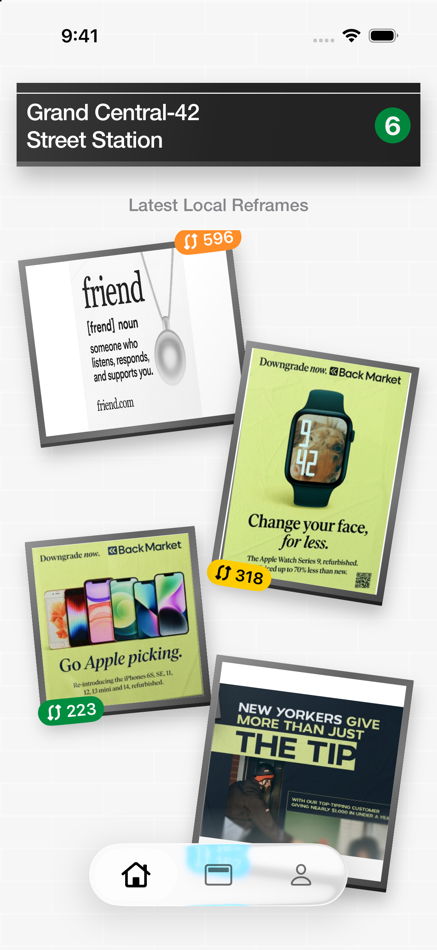
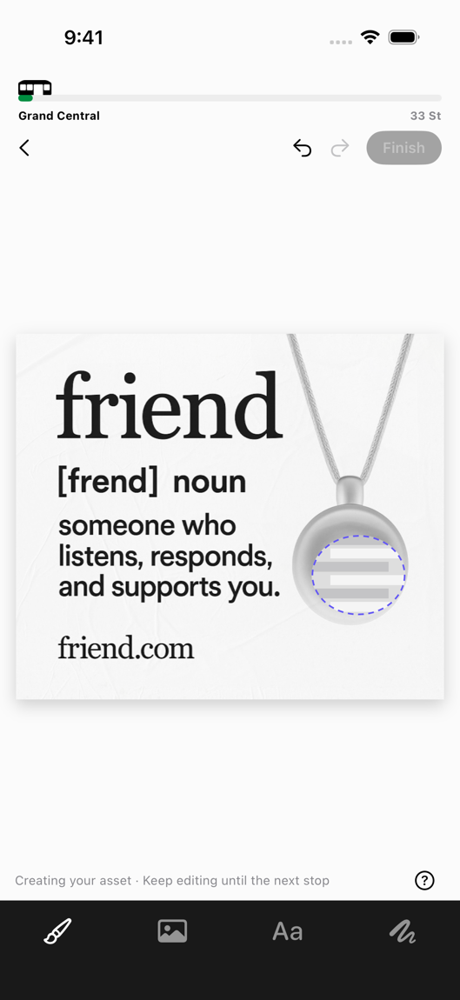
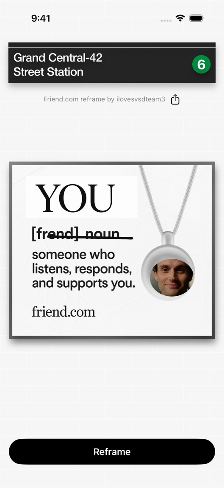
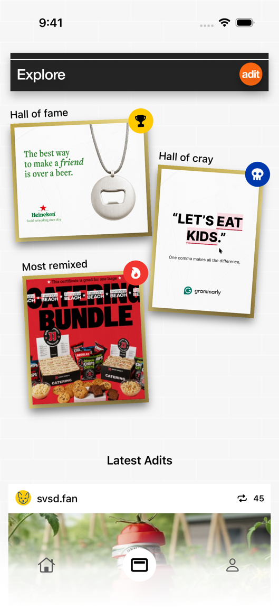

# Adit

A native iPhone app for remixing subway ads during a commute. The opening station is Grand Central–42 Street. Artwork, drafts, votes, bookmarks and published reframes live on the device.

  
  
  
  

[Watch the upward ad transition](Research/Simulator/Rolling.mp4). The floating navigation capsule supports tapping and dragging between destinations, with native Liquid Glass on iOS 26.

## Run

Open **Adit.xcodeproj** in Xcode, select the **Adit** scheme, choose an iPhone simulator and press **⌘R**. The deployment target is iOS 17. The project includes its assets and has no package dependencies. To install on a physical iPhone, select your development team in Signing & Capabilities and choose the connected phone as the run destination.

Tilt an iPhone to reveal the raised edges of station signs and poster frames. In Simulator, drag a sign or frame to preview the perspective. Reduce Motion keeps the surfaces still.

## Try the original journey

1. Tap the Friend poster with the orange **596** badge. Swipe between the campaign formats and select **Reframe**.
2. With **AI brush** selected, draw a circle on the pendant and enter “Joe Goldberg.” Send the request. The train indicator and striped selection show its progress.
3. Select **Brush** to cross out a line. Choose **Add text**, enter “YOU,” and place it on the poster. Drag the layer into position. Use the layer controls to resize, rotate, edit or delete it.
4. Open **Asset library** for original campaign art and remix material. Tap an asset to place it. Undo and redo are available during the editing session.
5. Choose **Finish** after the request resolves. Share exports a flattened image. **Reframe** returns the finished print to the wall.
6. Leave the editor with the back arrow to save a draft. Reopen it from **Artist profile → Drafts**. Explore has two award votes per poster and a bookmark that adds it to **Saved**.

The station sign opens the station selector, live 6-train timing and an optional notification demonstration. Tapping a nearby-ad invitation opens the campaign picker. An explicit tap on the notification demonstration requests iOS permission.

## Local services

The default ride lasts 16 seconds. Enable **Use live 6-train arrivals** from the station sign to follow the next southbound train. Adit reads the MTA GTFS-realtime feed, matches two consecutive stop predictions on the same trip, and stores the departure and arrival with each queued region. Missing or stale predictions use the offline preview. [MTA developer resources](https://www.mta.info/developers)

The standard prompt button works offline with original artwork, illustrated motifs and typographic stamps. Supported devices also show an **Image Playground** wand next to the prompt. It takes the circled region and prompt into Apple's generator and saves the accepted image with the composition. This path requires Image Playground support on the device. The simulator uses the offline renderer.

The seeded profile and feed represent the design examples. Drafts, new posts, awards and bookmarks are local. Geolocation, remote push, accounts and multi-user synchronization require additional integrations.

## Test

Choose **Product → Test** (**⌘U**) on an iPhone simulator. The UI test target uses its own library. It exercises publication, persistence across relaunch, drawing history, pending generation, text placement, votes, bookmarks, station changes, asset placement and draft deletion. Screenshots are attached to the test result.

The checked-in Xcode project runs as supplied. If changing target structure, regenerate it from **project.yml** with XcodeGen.

## Design record

- [Source-to-feature inventory](Research/Reconstruction.md) lists all 88 supplied Figma objects in canvas order.
- [Frame inventory](Research/FrameInventory.json) contains source text, children, dimensions and coordinates.
- [Build plan and recording study](Research/BuildPlan.md) records the acceptance criteria and timed sequences.
- [Coverage audit](Research/Coverage.md) records the implementation status and adaptations.
